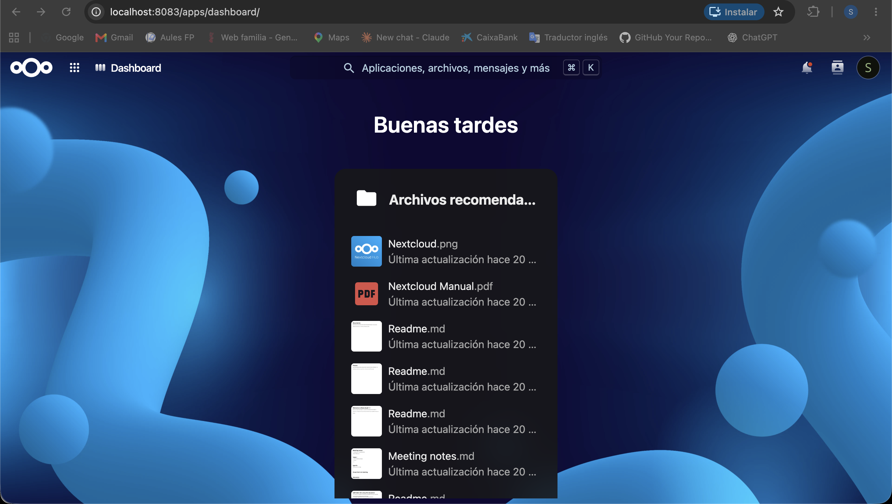
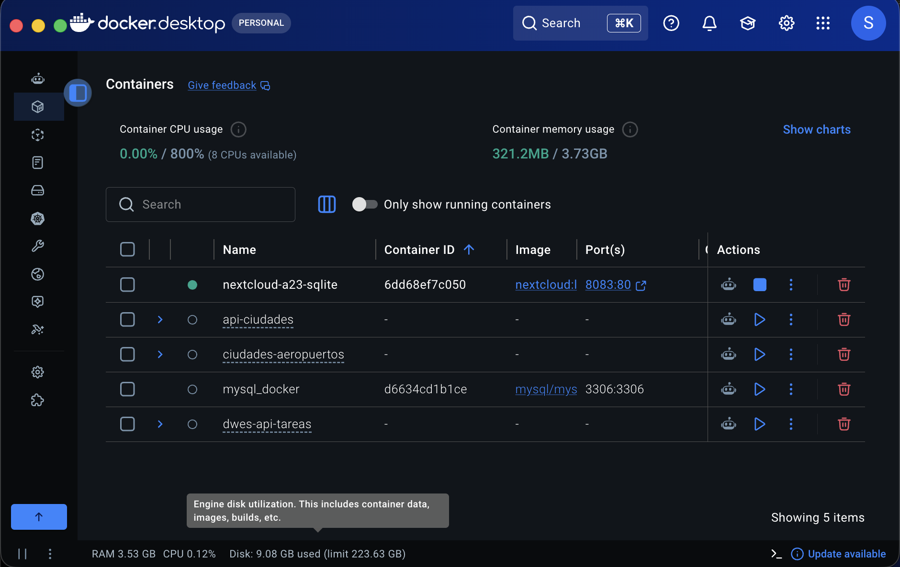
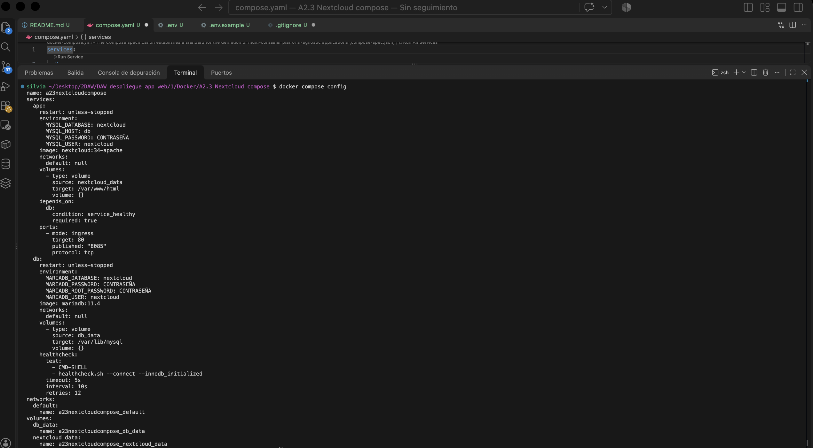
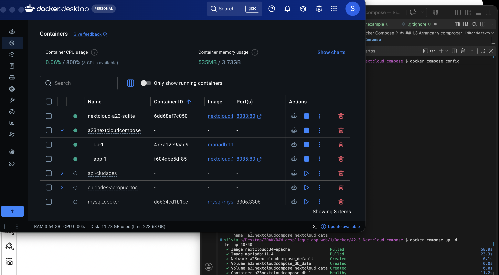
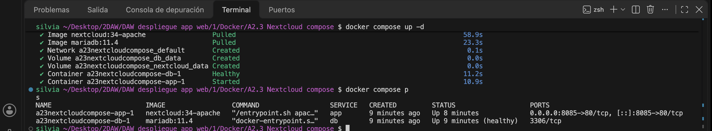
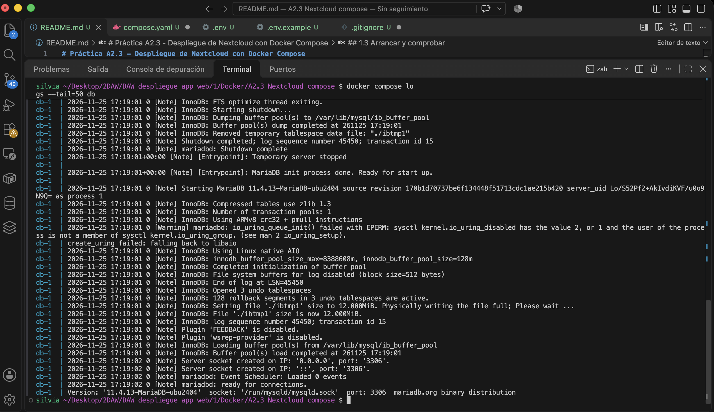
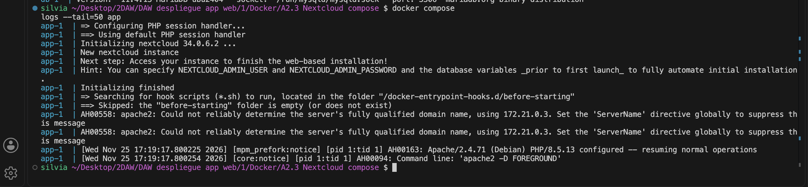
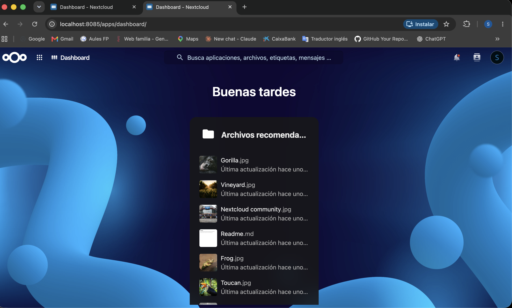
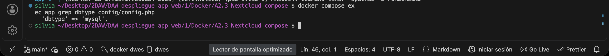

# Práctica A2.3 - Despliegue de Nextcloud con Docker Compose

## 0. Primera instalación con Docker

He instalado Nextcloud utilizando el comando 'docker run -d --name nextcloud-a23-sqlite \ -p 8083:80 \ nextcloud:latest'

- Contenedor: `nextcloud-a23-sqlite`
- Puerto: `8083`
- Dirección de acceso: http://localhost:8083

### Captura de la instalación

Página de inicio de nextcloud

Contenedor nextcloud

### Limitaciones de SQLite
SQLite es sencillo de utilizar, pero tiene limitaciones cuando trabajan varios usuarios a la vez. Una base de datos independiente como MariaDB permite gestionar mejor aplicaciones con más usuarios.

## 1.3 Arrancar y comprobar

`docker compose config`

`docker compose up -d`y contenedor a23nextcloudcompose con db-1 y app-1
Los crea y los levanta

`docker compose ps`

`docker compose logs --tail=50 db` registros de MariaDB

MariaDB se ha iniciado correctamente, en los registros aparece el mesaje `ready for connections`, que indica que la base de datos está preparada para recibir coneciones.

`docker compose logs --tail=50 app` Registros de nextcloud

Nextcloud se ha inicializado correctamente, en los registros aparece `Initializing finished`. El siguiente paso es completar la instalación desde el navegador.

### Instalación con MariaDB
Se ha completado la instalación de Nextcloud con MariaDB como base de datos desde el puerto 8085.

Se ha comprobado que está utilizando MariaDB porque aparece `mysql`, con el comando `docker compose exec app grep dbtype config/config.php`

### 1.4 Probar la persistencia

He añadido a nextcloud una imagen mía ( la reconocerás enseguida ), he ejecutado `docker compose down` y he comprobado que se han eliminado los contenedores, he ejecutado `docker compose up -d`, he vuelto al navegador, he cerrado sesión y vuelto a entrar y la foto sigue estando disponible, esto es posible porque los datos se almacenan en volúmenes persistentes.

### 1.5 Adaptar y diagnosticar

He cambiado el puerto de acceso 8085 por 8086 temporalmente y comprobado que funciona bien.

Con el comando `docker compose logs --tail=50 db` en los registros de MariaDB aparece el mensaje `ready for connections`, que nos indica que el servicio se ha iniciado correctamente y está preparado para recibir conexiones.

Con el comando `docker compose logs --tail=50 app` comprobamos que en los registros de nextcloud aparecen peticiones HTTP con respuestas 200 y 304.
Nos está indicando que la aplicación estña respondiendo correctamente a las peticiones del navegador.

### Explica qué ocurriría si MariaDB no estuviera preparada cuando Nextcloud intentase conectarse

Si MariaDB no está lista, Nextcloud espera a que esté preparada antes de iniciarse. Se controla en depends_on y service_healthy.

